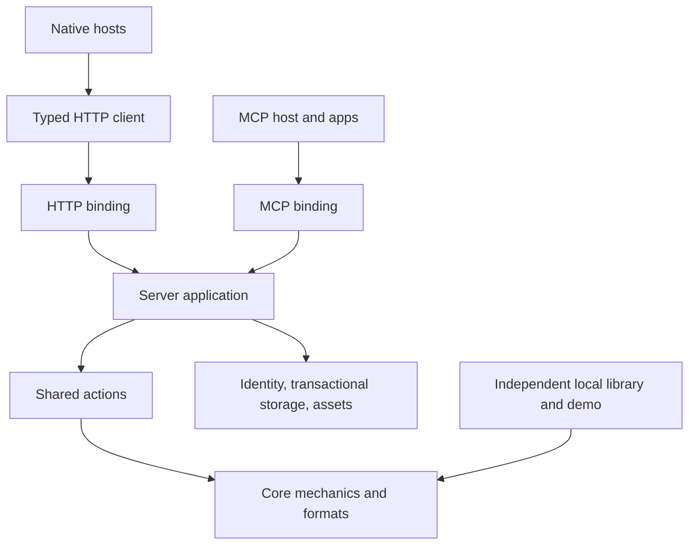

# Unified server and client architecture

Status: proposed

## Context and current implementation

[Issue #5](https://github.com/kmdavis/portents/issues/5) defines the boundaries for a shared host-neutral authenticated server, not its implementation. The [development guide](../AGENTS.md) and [roadmap](../ROADMAP.md) govern the package boundaries and staged product direction. No equivalent shared authenticated server, typed remote protocol, or transactional campaign implementation exists in the inspected sources.

The existing [storage port](../packages/core/src/ports/storage.ts) is single-writer text-key storage with per-value atomicity, not a multi-record transaction. [Campaign](../packages/core/src/campaign/campaign.ts) uses slug-based keys and injectable storage, clock, randomness, and registry. Its `PendingRoll` has an expression, reason, kind, DC, and timestamp, but no durable request identity or completed result. [Ledger](../packages/core/src/ledger/ledger.ts) serializes appends within one cached handle, not across independent processes. A transaction cannot be inferred from those guarantees.

The local [WebSession](../packages/web/src/session.ts) and [web facade](../packages/web/README.md) use injectable local storage, normally IndexedDB. `WebSession.roll` appends a ledger entry and updates counters separately. `Campaign.draw` updates piles and counters before its caller appends cards. The [pi adapter](../packages/pi/src/index.ts) directly opens home storage, caches an active `Campaign`, and implements `rollAndRecord`, `drawAndRecord`, and repeat handling. The [pi README](../packages/pi/README.md) describes the adapter; [parity fixtures](../packages/pi/PARITY.md) are migration anchors. The [site actions](../site/src/actions.ts) export `campaignAction`, `sheetAction`, `recallAction`, and `rememberAction`; [site tools](../site/src/tools.ts) dispatch capabilities and the [demo](../site/src/demo.ts) uses an in-memory `askRoll` dialog before `session.roll`. Pi instead persists an unnamed pending roll before confirmation and clears it separately. Neither path durably resolves and replays an identified roll atomically. The [CLI](../packages/cli/src/index.ts) is another direct consumer. Extraction must account for these actual paths, rather than assume orchestration is already shared.

## Relationship to decision 001

[Decision 001](001-settings-memory-and-rooms.md) remains accepted for its versioned Markdown resource envelope, stable IDs, legacy reads, audience metadata, immutable data-only packs, explicit registry overrides, image-map asset references, and host-owned compaction. Its statement that site and pi already share an action implementation is stale: they currently orchestrate equivalent operations independently.

The newer roadmap defers multiplayer and live synchronization. The experimental room coordinator is neither a durable authenticated server nor a dependency of the solo server. Provider execution and model-key management in 001 are not part of this release: inference and model credentials stay with the consuming host. When accepted, this record supersedes only those conflicting direction statements, not 001's resource contracts.

## Shared execution and dependency boundaries

| Boundary | Responsibility |
|---|---|
| Core | Existing mechanics, canonical formats, content contracts, validation, and renderers with injectable random, clock, and storage. No model SDK, inference, or runtime APIs outside explicit adapters. Direct pure-library use remains supported. |
| Shared actions | Complete gameplay use cases, including ledger, counter, pile, and pending-state effects, extracted rather than copied from web/site/pi/CLI orchestration. Reuse `roll`, `splitRepeat`, `formatRoll`, deck/table/oracle/map functions, sheet/resource methods, and registry semantics. |
| Server application | Resolve authenticated identity; authorize ownership, content, and assets; run actions within atomic persistence; select safe projections. Local, self-hosted, and cloud use one implementation, with no global active campaign or cached cross-request ledger as authority. |
| Typed protocol/client | Operation-specific serializable requests and results, runtime validation, versions, and stable error meanings. The client handles endpoint, authentication, and encoding, not gameplay or authoritative storage access. |
| HTTP/MCP bindings | Translate the same operations, results, and errors. MCP calls the shared application in process, not through a second HTTP hop or a separate gameplay stack. Native clients use the HTTP client; MCP Apps use supported authenticated bridge operations. |
| Composition | Inject verified-identity adapter, transactional persistence, installed registry and asset resolution, random/clock, and runtime startup/binding. Reuse sufficient ports; add seams only for real identity, runtime, or transaction differences. Entitlements are a small default-free policy check, not a rules engine or billing subsystem. |

Native hosts retain lifecycle, prompts, transcripts, UI, PNG facilities, and local model execution. MCP is not their lowest-common-denominator interface. Do not add event sourcing, buses, executable plugins, per-host gameplay services, inheritance frameworks, or a mandatory room coordinator.

## Protocol and transport contracts

Typed operations and shared runtime schemas cover dice and odds, decks, tables, oracle, maps and movement, sheets, campaigns, recall and remember, guidance, context, and ledger. Only plain data crosses transports: never live `Campaign`, `Storage`, registries, or SDK objects. Structured results include canonical ledger references when recorded and preserve contractually exact core formatting for native presentation and parity.

Campaign-scoped operations carry explicit server campaign identity. List/create, installed-content and guidance discovery, and explicitly ephemeral standalone mechanics need no campaign, but still authenticate. Ephemeral results never fabricate campaign ledger IDs. Selected campaign is client state, not global server state.

Version the public protocol independently from stored resource and archive schemas; reject unsupported versions. [#6](https://github.com/kmdavis/portents/issues/6) owns literal routes, JSON fields, operation names, error spellings, and schema-library selection. This decision fixes error meanings: invalid input/version; unauthenticated or revoked identity; unauthorized or unavailable resource; stale revision; conflicting idempotency reuse; and storage or capacity failure. HTTP and MCP preserve those meanings and never replace failures with plausible gameplay results.

HTTP is the portable transport for native clients. MCP exposes tool schemas, annotations, and UI bindings over the same actions, not an agent or GM loop. The server does not host model inference.

## Identity, authorization, and projections

Verified local credentials or hosted OAuth/OIDC identities resolve to a stable principal. The shared application authorizes campaigns, assets, and archives on every operation before exposure. Never trust a supplied owner, role, or audience, or expose arbitrary storage keys. [#7](https://github.com/kmdavis/portents/issues/7) owns identity contracts.

A local installer seeds a user and securely generated revocable credentials. Loopback is the default binding, not an authentication exemption. Defend loopback HTTP against untrusted browser origins and host-header attacks; cookie-based browser authentication, if introduced, also requires CSRF defenses. Widgets contain no model or server secrets.

Campaign ownership is distinct from player-safe projection. A solo owner may deliberately audit their own state; default player responses and widgets omit undiscovered terrain, hidden actors, private resources, and GM mechanics. Enforce authorization and projection before serialization for lists, queries, exact reads, context, ledger, maps, and assets—not merely through UI hiding. `Campaign.recallById` and query audience parameters are not authorization; the site's revealable secret ledger rows are local presentation. GM model access requires server authorization, and model-visible material is not secret from the platform or user. Tool annotations do not prove human consent or model/widget credential isolation.

## Transactional campaign commands

Mutations carry an expected campaign revision and durable idempotency identity scoped to principal and campaign. Creation and import use principal-scoped operation identity before allocation. Authorize before accessing replay data. Within the atomic boundary, replay identical completed input before rejecting its now-old revision; reject reuse for different input, and reject unseen stale commands before effects.

Commit state and documents, ledger entries and sequences, piles and counters, pending transitions, revision, and replay result together. Report success only after commit. A duplicate retry returns the original committed result and IDs without rolling again. A crash before commit exposes no partial effect; after commit it replays. This promises exactly-once committed effects, not exactly-once delivery or the absence of random work in aborted attempts.

Allocate append-only ledger identity at durable serialization. Writer suffixes and process queues do not coordinate independent writers. All state and ledger access must be transaction-scoped; wrapping calls whose writes escape the transaction is insufficient. Append and index ledger records incrementally, never rewrite an unbounded ledger blob for each command.

Preserve the existing single-writer `Storage` and conformance suite for library and demo consumers. [#8](https://github.com/kmdavis/portents/issues/8) adds a stronger transaction contract and suite. Per-key compare-and-swap, files plus a mutex, or passing current storage conformance does not prove atomicity across campaign, ledger, piles, and pending actions.

## Durable rolls and context

A player roll has a durable request ID and pending/terminal state. Commit its creation before opening a dialog or widget; do not hold a transaction while waiting. Authenticated resolution or decline refers to that request and atomically commits terminal state, the canonical ledger result when rolled, and replay data. A stale widget cannot change the expression or create a second result. Disconnect is not decline.

Native hosts may confirm and resolve within one tool invocation. MCP may return pending and continue on a later turn. If callbacks or approvals are unsupported, pause for explicit user action or supported authenticated native completion; never roll automatically or introduce a second GM. [#11](https://github.com/kmdavis/portents/issues/11) owns lifecycle; [#17](https://github.com/kmdavis/portents/issues/17) must prove actual model/widget privilege separation before it is claimed.

Context rehydrates scene, characters and status, clocks, pending actions, permitted recent ledger and journal, and relevant resources with revision. Reuse `Campaign.brief` coverage, not its unfiltered GM-facing string as a public API. Missing scene, sheet, or content is explicit absence or a problem, never invented state. The host owns compaction and inference.

## Campaign portability and canonical formats

Separate outer server campaign ID from display name and the preserved legacy slug/resource namespace. Scope storage by outer campaign so identical internal slugs coexist without rewriting `campaign/<slug>/...` resource IDs, journal references, or ledger citations. `Campaign.writeResource` validates that internal namespace; server identity must not alter it.

Frontmatter remains canonical in human-readable Markdown/resource/JSONL exports. Transactional stores may hold canonical documents alongside indexed records, but no independently editable duplicate Markdown truth. External file materializations are snapshots or exports, not live authority. Manual edits require explicit validated import and backups; never silently migrate destructively.

[#10](https://github.com/kmdavis/portents/issues/10) owns a versioned lossless archive of campaign documents, resources, sheets, journal, maps and owned assets, ledger, piles, pending and terminal action state needed for portable results, and stable pack/version references. Exclude credentials, OAuth/model keys, unrelated operational records, and restricted pack assets. Portable action history is distinct from account-scoped transport replay ownership.

Validate sizes, paths, checksums, versions, and dependencies before publishing imports. The authenticated importer becomes owner. Never overwrite on collision: allocate a new outer campaign ID while retaining the internal namespace, or explicitly reject if references cannot be preserved. Report missing, incompatible, or restricted packs without substitution or redistribution. There is no live sync.

## Deployment composition

| Deployment | Composition and constraints |
|---|---|
| Local Node | Same Node server/container and transports as hosted, with SQLite transactional store and file/asset handling; seeded secure identity and loopback default, with no signup or auth bypass. |
| Self-hosted | Same Node/Docker image and SQLite adapter with configured identity, persistent storage and independent backups, HTTPS, and binding operations; no gameplay fork. |
| Omens | Initially target Fly.io using the same Node.js/Docker image and SQLite transactional adapter, a persistent volume, hosted identity ([#25](https://github.com/kmdavis/portents/issues/25)), HTTPS/MCP, and independent backups. The maintainer already has a paid Fly.io account for another service; isolate Omens resources and credentials and measure its actual marginal billing, not assumed free allowances. A single volume limits availability and is not automatic multi-region failover. Owner isolation, client inference, free access at launch, and optional donations on an independent website remain subject to platform rules and measured capacity. No billing, paid restrictions, or marketplace; capacity upgrades and provider exit are deployment responsibilities. Cloudflare Workers/D1/Durable Objects/R2 are a possible future pivot, not an initial deliverable or prerequisite for #5/#9. |
| Browser-only demo | Preserve independent `WebSession`/IndexedDB library composition. Server-backed web is separate and never silently synchronizes or promotes local demo state. |

## Dependencies and migration

1. [#5](https://github.com/kmdavis/portents/issues/5) records boundaries. [#14](https://github.com/kmdavis/portents/issues/14) and [#17](https://github.com/kmdavis/portents/issues/17) are early host capability spikes gating UX promises, not mechanics.
2. [#6](https://github.com/kmdavis/portents/issues/6) extracts actions, protocol, and client against existing parity fixtures. [#7](https://github.com/kmdavis/portents/issues/7) identity and [#8](https://github.com/kmdavis/portents/issues/8) transactions proceed independently after their #6 contracts settle.
3. [#9](https://github.com/kmdavis/portents/issues/9) composes the local server from #6–#8. [#10](https://github.com/kmdavis/portents/issues/10) archives and [#11](https://github.com/kmdavis/portents/issues/11) lifecycle use those contracts and prove portability and resume.
4. [#12](https://github.com/kmdavis/portents/issues/12) and [#13](https://github.com/kmdavis/portents/issues/13) cut CLI and pi authoritative operations to the typed client, retaining CLI seed/JSON/PNG and pi prompt/lifecycle/confirmation/parity. [#15](https://github.com/kmdavis/portents/issues/15) follows #14; [#16](https://github.com/kmdavis/portents/issues/16) builds separate server-backed web. Preserve working library and demo paths during staged migration, but never run old and new writers concurrently on one campaign. At each cutover delete obsolete authoritative paths; network or authentication failure must not silently fall back to local mutation.
5. [#18](https://github.com/kmdavis/portents/issues/18), [#19](https://github.com/kmdavis/portents/issues/19), and [#20](https://github.com/kmdavis/portents/issues/20) supply MCP interface, generated guidance, and shared widgets after #17 findings. [#21](https://github.com/kmdavis/portents/issues/21) and [#22](https://github.com/kmdavis/portents/issues/22) validate thin platform integrations; [#23](https://github.com/kmdavis/portents/issues/23) owns distribution rules.
6. [#24](https://github.com/kmdavis/portents/issues/24) validates the initial Fly.io Node/container deployment, SQLite volume durability, backup/restore, restart/deploy behavior, workload and marginal costs; [#25](https://github.com/kmdavis/portents/issues/25) account adapters; [#26](https://github.com/kmdavis/portents/issues/26) cost and abuse controls; [#27](https://github.com/kmdavis/portents/issues/27) brand and website; [#28](https://github.com/kmdavis/portents/issues/28) beta operations. Cloudflare evaluation is deferred, not a prerequisite for #5 or #9. This record makes no production, branding, distribution, or cost-feasibility claim.

## Decisions and alternatives

| Decision | Alternative and reason |
|---|---|
| Extract shared actions. | Per-host gameplay duplicates orchestration and risks diverging mechanics and ledger effects. |
| One application for local and cloud. | Forks multiply authorization and gameplay implementations. |
| Typed operation contracts. | Remote storage access leaks authority and bypasses use-case validation. |
| Atomic command store. | Per-key CAS alone cannot commit multiple records and replay together. |
| Versioned archive transfer. | Live sync adds unresolved coordination and conflicts, and is deferred. |
| Native lifecycle plus reusable MCP. | MCP-only parity would discard host-specific confirmation and UI capabilities. |
| Capability gates. | Unsupported host promises can fabricate confirmation or exposure guarantees. |
| Logical modules with direct injection. | Speculative package and framework scaffolding freezes unproven runtime choices. |

## Unresolved decisions and feasibility gates

These are future work owned by existing issues, not tests run or claimed passed by #5.

| Selection or assumption | Owner | Required evidence | Failure consequence |
|---|---|---|---|
| Node/container parity | [#9](https://github.com/kmdavis/portents/issues/9), [#24](https://github.com/kmdavis/portents/issues/24) | Same authenticated create/read/command/error flow using the same Node/Docker image and SQLite adapter locally and on Fly.io, including HTTPS/MCP. | Fix composition or deployment while retaining ordinary portable Node contracts and one gameplay implementation; no Worker-specific abstraction or cloud fork. |
| SQLite transaction and volume durability | [#8](https://github.com/kmdavis/portents/issues/8), [#9](https://github.com/kmdavis/portents/issues/9), [#24](https://github.com/kmdavis/portents/issues/24) | Competing revisions, duplicate/conflicting keys, before/after-commit faults, restart and deployment prove atomic state/ledger/pile/pending/result and original replay on persistent storage; independently backed-up data restores correctly. | Correct or replace the deployment or adapter before release; never weaken atomicity, revisions, idempotency, or portability. A single volume is an availability limitation, not automatic failover. |
| Fly.io capacity, marginal cost and asset consistency | [#24](https://github.com/kmdavis/portents/issues/24), [#26](https://github.com/kmdavis/portents/issues/26) | Bounded growing-ledger/map workloads measure CPU, memory, load, volume growth, and actual marginal Fly.io billing; upload/publish faults prove no visible missing-object references. Test independent backup/restore and restart/deploy behavior. | Stage immutable assets before publishing references, keep incomplete imports invisible, recover orphans; adjust capacity, deployment, or provider if evidence requires. Existing account allowances do not guarantee free hosting. |
| ChatGPT/Claude capability and distribution | [#17](https://github.com/kmdavis/portents/issues/17), [#21](https://github.com/kmdavis/portents/issues/21), [#22](https://github.com/kmdavis/portents/issues/22), [#23](https://github.com/kmdavis/portents/issues/23) | Actual remote auth, approval, skill activation, model/user/widget exposure, callbacks/follow-up, mobile, custom endpoint, and distribution trials. | Document per-host limits; use pending/later-turn or explicit native completion; defer unsupported features and distribution, never auto-roll. |
| OMP/Tern native APIs and UI | [#14](https://github.com/kmdavis/portents/issues/14), [#15](https://github.com/kmdavis/portents/issues/15) | Actual lifecycle compatibility, semantic UI, maps, dialogs, and persistent panels. | Supported text/ASCII and explicit native player confirmation; never assume arbitrary HTML. |
| Identity, browser, and MCP flows | [#7](https://github.com/kmdavis/portents/issues/7), [#17](https://github.com/kmdavis/portents/issues/17), [#25](https://github.com/kmdavis/portents/issues/25) | Revocation, principal mapping, OAuth compatibility, cross-owner asset/replay isolation, and loopback-origin defense. | Reject unsupported credential flow; use a compatible identity adapter, never anonymous local mode. |
| Lossless archive and content resolution | [#10](https://github.com/kmdavis/portents/issues/10) | Cross-adapter round trip with colliding legacy slugs, additive frontmatter, missing pack versions, restricted/private assets, pending/terminal actions, and ledger. | Reject incompatible import before publication, preserve source and backup; explicit versioned migration in #10 if needed, no silent ID rewrite. |

## Acceptance scenarios for subsequent implementation

These are required future proofs, not verification performed for this record:

1. [#7](https://github.com/kmdavis/portents/issues/7)/[#9](https://github.com/kmdavis/portents/issues/9): clean local installation provisions credentials; anonymous requests fail; owner creates and reopens after restart; a second principal cannot list, read, mutate, export, or fetch assets; revoked credentials cannot retrieve replay.
2. [#6](https://github.com/kmdavis/portents/issues/6)/[#8](https://github.com/kmdavis/portents/issues/8): seeded `2d20kh1+5` matches current core/parity formatting and random-consumption order. Retry after lost response returns the original result and ledger ID with one append and revision increment. Changed payload with the same key fails; an unseen stale command changes nothing. A crash never exposes half a draw/pile/counter/ledger update.
3. [#11](https://github.com/kmdavis/portents/issues/11): request `1d20+5`, disconnect and restart, then rehydrate the same pending request; two-widget resolution produces one committed result with replay for valid retries. Decline produces no roll. Unsupported callback stays pending without an invented result.
4. [#7](https://github.com/kmdavis/portents/issues/7)/[#11](https://github.com/kmdavis/portents/issues/11)/[#18](https://github.com/kmdavis/portents/issues/18)/[#20](https://github.com/kmdavis/portents/issues/20): private resource and hidden actor/terrain are absent from player list, query, exact read, map, assets, context, and widget payload. Owner audit is explicit; UI hiding is not proof.
5. [#10](https://github.com/kmdavis/portents/issues/10)/[#24](https://github.com/kmdavis/portents/issues/24): export sheets, resources, frontmatter, linked IDs, maps, assets, ledger, piles, and pending and terminal actions; import into another authenticated deployment with colliding name/slug. Preserve references and data, reassign outer ownership, exclude credentials and restricted assets, and leave the source untouched.
6. [#12](https://github.com/kmdavis/portents/issues/12)–[#17](https://github.com/kmdavis/portents/issues/17): native clients retain supported lifecycle and confirmation; the independent IndexedDB demo remains useful; actual MCP/OMP limits are documented rather than fabricated.
